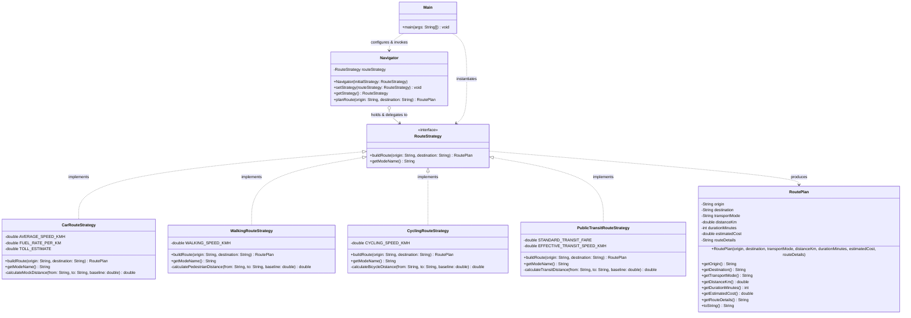

# Assignment #5 — Strategy Pattern Report

**Course:** ShP-2216 – Software Design Patterns  
**Academic Year:** 2026–2027 (2nd year, 4th trimester)  
**Institution:** Astana IT University – School of Software Engineering  
**Student:** Dias  
**GitHub Repository:** [https://github.com/HumbleCherry10/SDP-5](https://github.com/HumbleCherry10/SDP-5)  

---

## 1. Introduction

For this assignment, **Option A — Navigation / Route Planning** was selected. 

In real-world mapping systems (such as Google Maps, Apple Maps, or 2GIS), users need to calculate a route from point A to point B under fundamentally distinct transportation constraints:
- **Car / Driving:** Prioritizes motorways and arterial bypasses, accounts for road congestion, and estimates fuel and toll expenses.
- **Walking / Pedestrian:** Exploits pedestrian zones, parks, footbridges, and alley shortcuts while strictly avoiding highways and automobile freeways.
- **Bicycle / Cycling:** Favors dedicated bicycle trails and lanes, avoids steep gradients, and considers cycling safety.
- **Public Transit:** Integrates metro lines and bus schedules, accounts for fixed stop intervals, transfers, and flat fare tariffs.

The **Strategy Design Pattern** provides an ideal architectural solution by encapsulating each distinct routing algorithm within its own concrete strategy class behind a shared interface (`RouteStrategy`). A common context (`Navigator`) maintains a reference to the active strategy and delegates routing requests to it, enabling smooth runtime switching between transit modes without modifying context code.

---

## 2. UML Class Diagram

Below is the UML class diagram representing the system architecture (Context, Strategy interface, Concrete Strategies, and Client):



---

## 3. Clean Code Section

In accordance with *Clean Code* (Robert C. Martin, Ch. 10) and course guidelines, the implementation incorporates five fundamental Clean Code and architectural principles:

### Principle 1: Elimination of Conditional / Branching Logic in Favor of Polymorphism
* **Concept:** Avoid large `switch` or nested `if-else` cascades when selecting variant behavior. Polymorphic method invocation lets the runtime environment dispatch the call to the appropriate subtype.
* **Before (Anti-pattern with conditionals):**
  ```java
  public RoutePlan planRoute(String mode, String from, String to) {
      if (mode.equalsIgnoreCase("CAR")) {
          // calculate car route...
      } else if (mode.equalsIgnoreCase("WALK")) {
          // calculate walking route...
      } else if (mode.equalsIgnoreCase("BIKE")) {
          // calculate bike route...
      } else {
          throw new IllegalArgumentException("Unknown mode");
      }
  }
  ```
* **After (Polymorphic Strategy delegation in `Navigator`):**
  ```java
  public RoutePlan planRoute(String origin, String destination) {
      // Direct delegation with zero branching!
      return routeStrategy.buildRoute(origin, destination);
  }
  ```

---

### Principle 2: Meaningful, Intention-Revealing Names
* **Concept:** Class, method, and variable names should clearly express why they exist, what they do, and how they should be used without requiring comments to clarify their intent (*Clean Code*, Ch. 2).
* **Annotated Code Excerpt:**
  ```java
  // Explicit names convey domain semantics instantly:
  public interface RouteStrategy {
      RoutePlan buildRoute(String origin, String destination);
      String getModeName();
  }

  // Concrete classes express exactly the algorithmic vehicle/mode:
  public class CarRouteStrategy implements RouteStrategy { ... }
  public class WalkingRouteStrategy implements RouteStrategy { ... }
  public class CyclingRouteStrategy implements RouteStrategy { ... }
  public class PublicTransitRouteStrategy implements RouteStrategy { ... }
  ```

---

### Principle 3: Single Responsibility Principle (SRP)
* **Concept:** Each class must have one, and only one, reason to change. Each strategy is solely responsible for calculating routes for its specific mode of travel. `Navigator` is responsible only for orchestrating the strategy reference.
* **Annotated Code Excerpt:**
  ```java
  // WalkingRouteStrategy only changes if pedestrian routing rules change
  public class WalkingRouteStrategy implements RouteStrategy {
      private static final double WALKING_SPEED_KMH = 4.8;

      @Override
      public RoutePlan buildRoute(String origin, String destination) {
          // Exclusively contains pedestrian pathway calculations
          double baseDistance = calculatePedestrianDistance(origin, destination, 6.2);
          int durationMinutes = (int) Math.round((baseDistance / WALKING_SPEED_KMH) * 60);
          return new RoutePlan(origin, destination, getModeName(), baseDistance, durationMinutes, 0.0, ...);
      }
  }
  ```

---

### Principle 4: Context Remains Algorithm-Agnostic (Dependency Inversion Principle)
* **Concept:** High-level modules (`Navigator`) do not depend on low-level modules (`CarRouteStrategy`, `WalkingRouteStrategy`). Both depend on the abstraction (`RouteStrategy`). The Context knows nothing about speeds, fuel, or turn-by-turn logic.
* **Annotated Code Excerpt:**
  ```java
  public class Navigator {
      // Depends strictly on abstraction, decoupled from concrete details
      private RouteStrategy routeStrategy;

      public Navigator(RouteStrategy initialStrategy) {
          setStrategy(initialStrategy);
      }

      public void setStrategy(RouteStrategy routeStrategy) {
          this.routeStrategy = Objects.requireNonNull(routeStrategy, "RouteStrategy cannot be null");
      }
  }
  ```

---

### Principle 5: Open/Closed Principle (OCP) & Easy Extensibility
* **Concept:** Software entities should be open for extension, but closed for modification. We demonstrated this by adding `PublicTransitRouteStrategy` (bus/metro) without altering a single line of `Navigator`, `CarRouteStrategy`, `WalkingRouteStrategy`, or `CyclingRouteStrategy`.
* **Annotated Code Excerpt:**
  ```java
  // Seamlessly introducing a new transit algorithm without modifying existing classes:
  public class PublicTransitRouteStrategy implements RouteStrategy {
      @Override
      public RoutePlan buildRoute(String origin, String destination) {
          // Bus/metro specific timetable & transit logic
          return new RoutePlan(origin, destination, getModeName(), 15.0, 49, 1.75, "Metro Line 1 -> Bus 42");
      }
      @Override
      public String getModeName() { return "Public Transit (Metro / Bus)"; }
  }
  ```

---

## 4. Strategy vs. State

While both **Strategy** and **State** share identical structural UML diagrams (a Context delegating to an interface with multiple concrete implementations), their intent and behavioral lifecycle are fundamentally different:

1. **Client Control vs. Autonomous Internal Transitions:**
   - In the **Strategy Pattern**, the client explicitly configures and selects the algorithm appropriate for its external goal (e.g., the user chooses whether to drive, cycle, or walk). The strategies are typically independent, interchangeable alternatives that do not know about each other.
   - In the **State Pattern**, state transitions occur *internally and automatically* in response to context events (e.g., an order moving from `Placed` $\rightarrow$ `Paid` $\rightarrow$ `Shipped`). The states often hold references to the context and trigger transitions to succeeding states.

2. **Why Navigation Calls for Strategy:**
   Route calculation does not represent internal states of an entity going through a lifecycle. A user does not automatically "transition" from a car into a bicycle because of internal context states. Instead, driving, walking, and cycling are independent, interchangeable algorithmic strategies chosen at will by the caller to solve a specific computation. Hence, Strategy is the precise and correct design pattern.

---

## 5. Conclusion

Adopting the Strategy design pattern provides significant architectural advantages:
- **Flexibility & Maintainability:** Adding or tweaking route calculation algorithms has zero side effects on existing code, eliminating regressions and large fragile conditional blocks.
- **Trade-off Evaluation:** The pattern introduces additional classes (`RouteStrategy` interface and one class per variant). However, in any non-trivial application, this minor overhead is overwhelmingly justified by the clean separation of concerns, testability of individual algorithms in isolation, and compliance with SOLID design principles.

---

## 6. GitHub Repository Link

The complete source code, incremental commit history, and execution instructions are hosted at:  
👉 **[https://github.com/HumbleCherry10/SDP-5](https://github.com/HumbleCherry10/SDP-5)**
